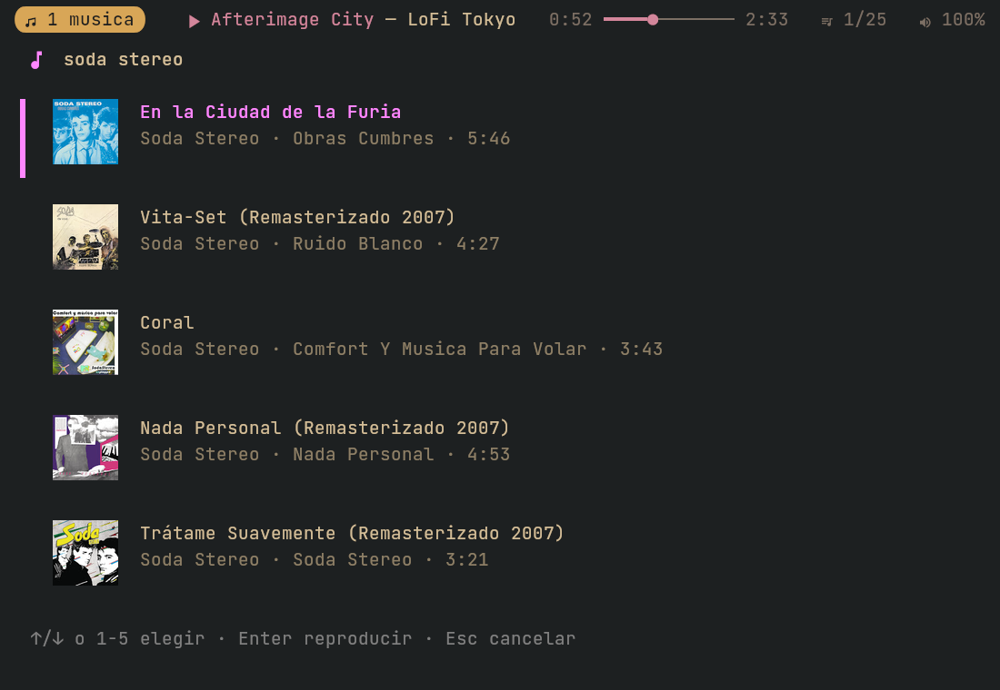
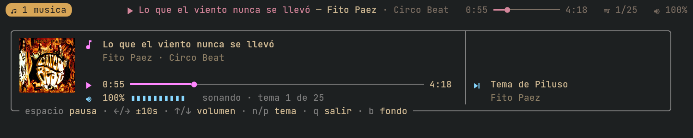
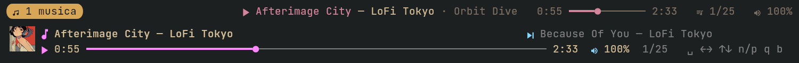

# musica 🎵

[English](README.md) · **Español**

Música de **YouTube Music en la terminal**, solo audio, liviana y manejable desde el teclado.

Buscás un tema, elegís entre 5 resultados (con la tapa del álbum si usás Kitty) y suena con `mpv`. Después del tema
elegido sigue sola una **radio de canciones parecidas**, igual que en YouTube Music.

```
musica soda stereo
```







## Qué tiene

- 🔎 **Búsqueda en YouTube Music** filtrada a canciones (no videos de usuarios ni compilados), con menú de 5 opciones
  navegable con flechas y tapa del álbum en miniatura.
- 📻 **Radio automática**: el tema elegido + ~24 temas parecidos que recomienda YouTube Music.
- 🖥️ **Reproductor en la terminal**: tapa, título, artista, álbum, barra de progreso, volumen, tema anterior y siguiente.
- ➖ **Modo barra** (`-m`): el reproductor en 1 o 2 líneas, para un split chiquito. Los títulos largos se desplazan
  como una cartelera.
- 🌙 **Modo de fondo** (`-b`): la música sigue aunque cierres la terminal; se maneja con atajos o `musica ctl`.
- 🧩 **Kitty** (opcional): barra de pestañas redondeada que muestra lo que suena y atajos de teclado.
- 🎛️ **Controles del escritorio** (opcional): con `mpv-mpris`, aparece en el applet de sonido (Cinnamon, GNOME, KDE…)
  y funcionan las teclas multimedia.
- 🪶 **Liviano**: ~100 MB de RAM (mpv), contra cientos de MB de una pestaña de YouTube Music en el navegador.

## Requisitos

| Qué | Para qué | Instalación (Debian / Ubuntu / Mint) |
|---|---|---|
| Linux | probado en Linux Mint 21.2 (Cinnamon) con mpv 0.34 | — |
| [`uv`](https://docs.astral.sh/uv/) | corre el script con sus dependencias aisladas (Python ≥ 3.10) | `curl -LsSf https://astral.sh/uv/install.sh \| sh` |
| `mpv` | reproduce el audio | `sudo apt install mpv` |
| [`yt-dlp`](https://github.com/yt-dlp/yt-dlp) | obtiene el audio de YouTube | `uv tool install 'yt-dlp[default]'` |
| Deno, Bun o Node | yt-dlp lo necesita para que YouTube no limite la velocidad | ver [paso 3](#3-runtime-de-javascript-para-yt-dlp) |
| [Kitty](https://sw.kovidgoyal.net/kitty/) *(opcional)* | tapas de álbum, íconos y barra de pestañas | probado en 0.46 |
| `mpv-mpris` *(opcional)* | applet de sonido y teclas multimedia | `sudo apt install mpv-mpris` |

> El `yt-dlp` de `apt` suele estar desactualizado y YouTube lo rompe seguido; por eso se instala con `uv tool`
> (se actualiza con `uv tool upgrade yt-dlp`).

## Instalación

### 1. Dependencias

```bash
curl -LsSf https://astral.sh/uv/install.sh | sh      # si no tenés uv
sudo apt install mpv
uv tool install 'yt-dlp[default]'
```

### 2. El comando `musica`

```bash
git clone https://github.com/Cocho92/musica-terminal.git
cd musica-terminal
install -Dm755 musica ~/.local/bin/musica
```

`~/.local/bin` tiene que estar en tu `PATH` (en la mayoría de las distros ya lo está). La primera vez que lo corras,
`uv` instala solo la librería [`ytmusicapi`](https://github.com/sigma67/ytmusicapi) en un entorno aislado.

### 3. Runtime de JavaScript para yt-dlp

YouTube manda un desafío en JavaScript; sin algo que lo resuelva, limita la velocidad y la música se corta.

- **Deno**: yt-dlp lo usa solo, no hay que configurar nada.
- **Bun o Node**: hay que indicárselo a yt-dlp:
  ```bash
  mkdir -p ~/.config/yt-dlp
  cp yt-dlp/config ~/.config/yt-dlp/config
  # editá el archivo y descomentá la línea de bun o node con su ruta (`which bun`)
  ```

Para verificarlo: `yt-dlp -F "https://music.youtube.com/watch?v=sWft4cMiwXQ"` no debería mostrar la advertencia
*"No supported JavaScript runtime could be found"*.

### 4. Kitty *(opcional)*

```bash
cp kitty/tab_bar.py kitty/musica.conf ~/.config/kitty/
echo 'include musica.conf' >> ~/.config/kitty/kitty.conf
```

Después **cerrá y abrí Kitty** (recargar la configuración no alcanza para la barra de pestañas).
Ojo: `musica.conf` cambia el estilo de tu barra de pestañas (`tab_bar_style custom`); si ya tenías una barra propia,
revisá el archivo antes.

### 5. Applet de sonido y teclas multimedia *(opcional)*

```bash
sudo apt install mpv-mpris
```

No hay que configurar nada: `mpv` carga el plugin solo.

## Uso

```bash
musica <búsqueda>          # menú → reproduce y abre el reproductor
musica -m <búsqueda>       # igual, pero en modo barra (1-2 líneas)
musica -b <búsqueda>       # menú → queda sonando de fondo y te devuelve la terminal
musica ui                  # abre el reproductor de lo que está sonando
musica ui -m               # lo mismo en modo barra
musica -l <búsqueda>       # solo lista los 5 resultados
musica -b -n 2 <búsqueda>  # reproduce el resultado 2 de fondo, sin menú (para scripts)
```

Controles desde cualquier terminal:

```bash
musica ctl status                  # qué suena
musica ctl toggle | pause | play
musica ctl next | prev
musica ctl vol 50 | +10 | -10
musica ctl seek +30 | -30 | 120
musica ctl stop
```

### Teclas

**Menú de resultados**

| Tecla | Acción |
|---|---|
| `↑` / `↓` | moverse |
| `Enter` o `1`–`5` | reproducir |
| `Esc` / `q` | cancelar |

**Reproductor y modo barra**

| Tecla | Acción |
|---|---|
| `espacio` | pausa / sigue |
| `←` / `→` | atrasar / adelantar 10 s |
| `↑` / `↓` | volumen |
| `n` / `p` | tema siguiente / anterior |
| `q` | salir **y parar** la música |
| `b` | salir y **dejar la música de fondo** |

Cerrar la terminal del reproductor también para la música. Lo que pusiste con `-b` sigue sonando hasta
`musica ctl stop`.

**Atajos de Kitty** (si instalaste `musica.conf`)

| Atajo | Acción |
|---|---|
| `Alt+Shift+Espacio` | pausa / sigue |
| `Alt+Shift+N` / `P` | siguiente / anterior |
| `Alt+Shift+K` / `J` | volumen + / − |
| `Alt+Shift+S` | parar |

### Varias terminales

Si tenés el reproductor abierto en una terminal y buscás algo desde otra, la música cambia **en el mismo
reproductor** (se actualizan tapa, título y cola) y la segunda terminal queda libre.

## Integración con Claude Code *(opcional)*

`claude/SKILL.md` es una [skill](https://docs.claude.com/en/docs/claude-code/skills) para que
[Claude Code](https://claude.com/claude-code) maneje la música cuando se lo pedís ("poné algo de jazz", "pausá",
"pasá a la siguiente"): busca, te muestra las 5 opciones y reproduce la que elijas de fondo.

```bash
mkdir -p ~/.claude/skills/musica
cp claude/SKILL.md ~/.claude/skills/musica/SKILL.md
```

## Cómo funciona

```
ytmusicapi ── búsqueda y radio (YouTube Music) ──┐
                                                 ▼
musica ── cola de ~25 temas ──► mpv (de fondo, socket IPC) ◄── yt-dlp baja el audio (HLS)
   │                              ▲   ▲
   └─ reproductor / barra ────────┘   └── Kitty (barra y atajos), mpv-mpris (applet y teclas multimedia)
```

- `musica` es un solo script de Python que corre con `uv run --script` (declara sus dependencias al principio).
- La música la reproduce un `mpv` **independiente de la terminal**; todo lo demás (reproductor, barra, `ctl`,
  Kitty) le habla por un socket en `$XDG_RUNTIME_DIR/musica-mpv.sock`.
- Los datos de la cola (títulos, artistas, tapas) quedan en `$XDG_RUNTIME_DIR/musica-now.json`.
- Elige y arma la cola desde **YouTube Music**; el audio de cada tema se pide por `www.youtube.com/watch?v=ID`
  (mismo archivo, verificado byte a byte) porque es la forma que `mpv-mpris` reconoce para mostrar la tapa.
- Usa el formato de streaming HLS (`234`/`233`, AAC ~128 kbps): con el audio directo, YouTube a veces responde 403.

## Problemas comunes

| Síntoma | Solución |
|---|---|
| Se corta, `Buffering`, `Cache: 0.0s` | falta el runtime de JavaScript ([paso 3](#3-runtime-de-javascript-para-yt-dlp)) |
| Error 403 o deja de encontrar/reproducir | `uv tool upgrade yt-dlp` (YouTube cambia seguido) |
| Falla la búsqueda | cambió YouTube Music; forzá la versión nueva de `ytmusicapi` con `uv run --refresh-package ytmusicapi --script ~/.local/bin/musica -l prueba` |
| Íconos raros (símbolos de otro idioma) en Kitty | otra fuente instalada pisa esos códigos; los íconos de este proyecto ya usan el rango Material Design (U+F0000+) para evitarlo |
| La barra de Kitty no cambia | cerrá y abrí Kitty por completo |
| Los atajos de Kitty no hacen nada | Kitty no encuentra `musica`: poné la ruta completa en `musica.conf` |
| Se ve `watch?v=…` en vez del título | el tema todavía está cargando; aparece en 1-2 s |

Los errores de la última reproducción quedan en `$XDG_RUNTIME_DIR/musica.log`.

## Proyectos parecidos

Si `musica` no es lo que buscás, estos son otros reproductores de YouTube Music para la terminal que vale la pena mirar:

| Proyecto | Lenguaje | Lo destacado |
|---|---|---|
| [ytm-player](https://github.com/peternaame-boop/ytm-player) | Python | TUI muy completa: atajos tipo vim, letras sincronizadas, teclas multimedia; con paquetes para varias distros |
| [youtube-music-cli](https://github.com/involvex/youtube-music-cli) | TypeScript | TUI hecha con React/Ink, con sistema de plugins; usa mpv y yt-dlp |
| [YTerMusic](https://github.com/ccgauche/ytermusic) | Rust | rápido y enfocado en privacidad; puede usar tu cuenta de YouTube Music |
| [yewtube](https://github.com/mps-youtube/yewtube) | Python | veterano, para YouTube en general (no solo Music): listas locales, MPRIS, Last.fm |
| [ytm](https://github.com/MaheshBhushan/yt-music-cli) | Python | receta muy parecida (ytmusicapi + yt-dlp + mpv): búsqueda, cola, radio, letras |
| [ytui-music](https://github.com/sudipghimire533/ytui-music) | Rust | TUI con mpv; sin cambios desde 2025 |
| [yt-music-tui](https://github.com/exar1o/yt-music-tui) | Python | un solo script con curses, muy simple |

Lo que suma `musica`: integración con Kitty (tapas y barra de pestañas con lo que suena), la música corre aparte de
la terminal (`musica ctl`, modo de fondo, atajos globales), modo barra de 1-2 líneas, una skill para Claude Code, y es
un solo archivo que se instala copiándolo. Lo que tienen otros y `musica` no: letras, entrar con tu cuenta (tus
playlists y "me gusta") y biblioteca.

## Aviso

Proyecto personal, no afiliado a Google ni a YouTube. Usa [`ytmusicapi`](https://github.com/sigma67/ytmusicapi)
(API no oficial) y [`yt-dlp`](https://github.com/yt-dlp/yt-dlp); cualquiera de los dos puede dejar de funcionar si
YouTube cambia algo, hasta que los actualicen. Usalo respetando los términos de servicio de YouTube.

## Licencia

[MIT](LICENSE) © Marco Piatti
