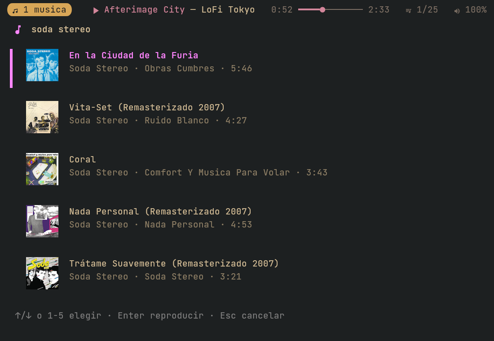
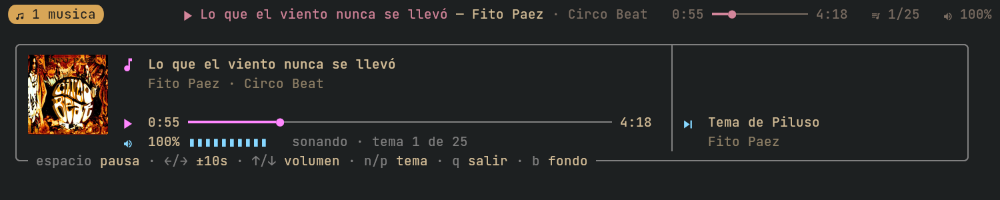
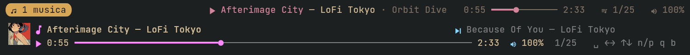

# musica 🎵

**English** · [Español](README.es.md)

**YouTube Music in your terminal** — audio only, lightweight and keyboard-driven.

Search for a song, pick one of 5 results (with album art if you use Kitty) and it plays through `mpv`. After the song
you picked, a **radio of similar songs** keeps going on its own, just like in YouTube Music.

```
musica soda stereo
```

> The command and its interface are in Spanish (*musica* = music). Everything is explained below.







## Features

- 🔎 **YouTube Music search** filtered to songs (no user uploads or compilations), with a 5-option menu you browse with
  the arrow keys, and small album covers.
- 📻 **Automatic radio**: the song you picked + ~24 similar songs recommended by YouTube Music.
- 🖥️ **Terminal player**: album art, title, artist, album, progress bar, volume, previous and next song.
- ➖ **Bar mode** (`-m`): the player in 1 or 2 lines, for a small split. Long titles scroll like a marquee.
- 🌙 **Background mode** (`-b`): music keeps playing even if you close the terminal; control it with shortcuts or
  `musica ctl`.
- 🧩 **Kitty** (optional): rounded tab bar showing what's playing, plus keyboard shortcuts.
- 🎛️ **Desktop controls** (optional): with `mpv-mpris` it shows up in the sound applet (Cinnamon, GNOME, KDE…) and
  media keys work.
- 🪶 **Lightweight**: ~100 MB of RAM (mpv), versus hundreds of MB for a YouTube Music browser tab.

## Requirements

| What | Why | Install (Debian / Ubuntu / Mint) |
|---|---|---|
| Linux | tested on Linux Mint 21.2 (Cinnamon) with mpv 0.34 | — |
| [`uv`](https://docs.astral.sh/uv/) | runs the script with its own isolated dependencies (Python ≥ 3.10) | `curl -LsSf https://astral.sh/uv/install.sh \| sh` |
| `mpv` | plays the audio | `sudo apt install mpv` |
| [`yt-dlp`](https://github.com/yt-dlp/yt-dlp) | fetches the audio from YouTube | `uv tool install 'yt-dlp[default]'` |
| Deno, Bun or Node | yt-dlp needs it so YouTube doesn't throttle the download | see [step 3](#3-javascript-runtime-for-yt-dlp) |
| [Kitty](https://sw.kovidgoyal.net/kitty/) *(optional)* | album art, icons and tab bar | tested on 0.46 |
| `mpv-mpris` *(optional)* | sound applet and media keys | `sudo apt install mpv-mpris` |

> The `yt-dlp` from `apt` is usually outdated and YouTube breaks it often; that's why it's installed with `uv tool`
> (update it with `uv tool upgrade yt-dlp`).

## Installation

### 1. Dependencies

```bash
curl -LsSf https://astral.sh/uv/install.sh | sh      # if you don't have uv
sudo apt install mpv
uv tool install 'yt-dlp[default]'
```

### 2. The `musica` command

```bash
git clone https://github.com/Cocho92/musica-terminal.git
cd musica-terminal
install -Dm755 musica ~/.local/bin/musica
```

`~/.local/bin` must be in your `PATH` (it already is on most distros). The first time you run it, `uv` installs the
[`ytmusicapi`](https://github.com/sigma67/ytmusicapi) library into an isolated environment on its own.

### 3. JavaScript runtime for yt-dlp

YouTube sends a JavaScript challenge; if nothing solves it, it throttles the speed and playback stutters.

- **Deno**: yt-dlp uses it automatically, nothing to configure.
- **Bun or Node**: you have to tell yt-dlp:
  ```bash
  mkdir -p ~/.config/yt-dlp
  cp yt-dlp/config ~/.config/yt-dlp/config
  # edit the file and uncomment the bun or node line with its path (`which bun`)
  ```

To check it: `yt-dlp -F "https://music.youtube.com/watch?v=sWft4cMiwXQ"` should not show the warning
*"No supported JavaScript runtime could be found"*.

### 4. Kitty *(optional)*

```bash
cp kitty/tab_bar.py kitty/musica.conf ~/.config/kitty/
echo 'include musica.conf' >> ~/.config/kitty/kitty.conf
```

Then **quit and reopen Kitty** (reloading the config is not enough for the tab bar).
Note: `musica.conf` changes your tab bar style (`tab_bar_style custom`); if you already had a custom tab bar, check
the file first.

### 5. Sound applet and media keys *(optional)*

```bash
sudo apt install mpv-mpris
```

Nothing to configure: `mpv` loads the plugin by itself.

## Usage

```bash
musica <search>            # menu → plays and opens the player
musica -m <search>         # same, but in bar mode (1-2 lines)
musica -b <search>         # menu → keeps playing in the background and gives you the terminal back
musica ui                  # opens the player for whatever is playing
musica ui -m               # same, in bar mode
musica -l <search>         # just lists the 5 results
musica -b -n 2 <search>    # plays result 2 in the background, no menu (for scripts)
```

Controls from any terminal:

```bash
musica ctl status                  # what's playing
musica ctl toggle | pause | play
musica ctl next | prev
musica ctl vol 50 | +10 | -10
musica ctl seek +30 | -30 | 120
musica ctl stop
```

### Keys

**Results menu**

| Key | Action |
|---|---|
| `↑` / `↓` | move |
| `Enter` or `1`–`5` | play |
| `Esc` / `q` | cancel |

**Player and bar mode**

| Key | Action |
|---|---|
| `space` | pause / resume |
| `←` / `→` | back / forward 10 s |
| `↑` / `↓` | volume |
| `n` / `p` | next / previous song |
| `q` | quit **and stop** the music |
| `b` | quit and **keep the music playing in the background** |

Closing the player's terminal also stops the music. Whatever you started with `-b` keeps playing until
`musica ctl stop`.

**Kitty shortcuts** (if you installed `musica.conf`)

| Shortcut | Action |
|---|---|
| `Alt+Shift+Space` | pause / resume |
| `Alt+Shift+N` / `P` | next / previous |
| `Alt+Shift+K` / `J` | volume + / − |
| `Alt+Shift+S` | stop |

### Several terminals

If the player is open in one terminal and you search from another one, the music changes **in the same player**
(album art, title and queue update) and the second terminal is free again.

## Claude Code integration *(optional)*

`claude/SKILL.md` is a [skill](https://docs.claude.com/en/docs/claude-code/skills) that lets
[Claude Code](https://claude.com/claude-code) handle the music when you ask for it ("play some jazz", "pause",
"next song"): it searches, shows you the 5 options and plays the one you pick in the background. The skill is
written in Spanish; Claude understands it either way.

```bash
mkdir -p ~/.claude/skills/musica
cp claude/SKILL.md ~/.claude/skills/musica/SKILL.md
```

## How it works

```
ytmusicapi ── search and radio (YouTube Music) ──┐
                                                 ▼
musica ── queue of ~25 songs ──► mpv (background, IPC socket) ◄── yt-dlp fetches the audio (HLS)
   │                               ▲   ▲
   └─ player / bar ────────────────┘   └── Kitty (tab bar and shortcuts), mpv-mpris (applet and media keys)
```

- `musica` is a single Python script run with `uv run --script` (it declares its dependencies at the top).
- Music is played by an `mpv` process **independent from the terminal**; everything else (player, bar, `ctl`, Kitty)
  talks to it through a socket at `$XDG_RUNTIME_DIR/musica-mpv.sock`.
- Queue data (titles, artists, covers) is stored in `$XDG_RUNTIME_DIR/musica-now.json`.
- Songs are chosen and queued from **YouTube Music**; each song's audio is requested through
  `www.youtube.com/watch?v=ID` (same file, verified byte by byte) because that's the form `mpv-mpris` recognizes to
  show the cover.
- It uses the HLS streaming format (`234`/`233`, AAC ~128 kbps): with the direct audio formats, YouTube sometimes
  answers 403.

## Troubleshooting

| Symptom | Fix |
|---|---|
| Stutters, `Buffering`, `Cache: 0.0s` | missing JavaScript runtime ([step 3](#3-javascript-runtime-for-yt-dlp)) |
| 403 error, or it stops finding/playing songs | `uv tool upgrade yt-dlp` (YouTube changes often) |
| Search fails | YouTube Music changed; force the latest `ytmusicapi` with `uv run --refresh-package ytmusicapi --script ~/.local/bin/musica -l test` |
| Weird icons (symbols from another script) in Kitty | another installed font overrides those code points; this project's icons already use the Material Design range (U+F0000+) to avoid it |
| The Kitty tab bar doesn't change | quit and reopen Kitty completely |
| Kitty shortcuts do nothing | Kitty can't find `musica`: use the full path in `musica.conf` |
| `watch?v=…` shown instead of the title | the song is still loading; it appears in 1-2 s |

Errors from the last playback are in `$XDG_RUNTIME_DIR/musica.log`.

## Similar projects

If `musica` isn't what you're looking for, these are other terminal YouTube Music players worth a look:

| Project | Language | Highlights |
|---|---|---|
| [ytm-player](https://github.com/peternaame-boop/ytm-player) | Python | full-featured TUI: vim keybindings, synced lyrics, media keys; packaged for several distros |
| [youtube-music-cli](https://github.com/involvex/youtube-music-cli) | TypeScript | TUI built with React/Ink, plugin system; uses mpv and yt-dlp |
| [YTerMusic](https://github.com/ccgauche/ytermusic) | Rust | fast and privacy-focused; can use your YouTube Music account |
| [yewtube](https://github.com/mps-youtube/yewtube) | Python | veteran YouTube (not only Music) player: local playlists, MPRIS, Last.fm |
| [ytm](https://github.com/MaheshBhushan/yt-music-cli) | Python | very similar recipe (ytmusicapi + yt-dlp + mpv): search, queue, radio, lyrics |
| [ytui-music](https://github.com/sudipghimire533/ytui-music) | Rust | TUI with mpv; not updated since 2025 |
| [yt-music-tui](https://github.com/exar1o/yt-music-tui) | Python | a single, very simple curses script |

What `musica` adds: Kitty integration (album art and a tab bar showing what's playing), playback that lives outside
the terminal (`musica ctl`, background mode, global shortcuts), a 1-2 line bar mode, a Claude Code skill, and it's a
single file you install by copying it. What others have and `musica` doesn't: lyrics, signing in to your account
(your playlists and likes) and a library.

## Disclaimer

Personal project, not affiliated with Google or YouTube. It uses [`ytmusicapi`](https://github.com/sigma67/ytmusicapi)
(unofficial API) and [`yt-dlp`](https://github.com/yt-dlp/yt-dlp); either may stop working when YouTube changes
something, until they are updated. Use it in accordance with YouTube's terms of service.

## License

[MIT](LICENSE) © Marco Piatti
